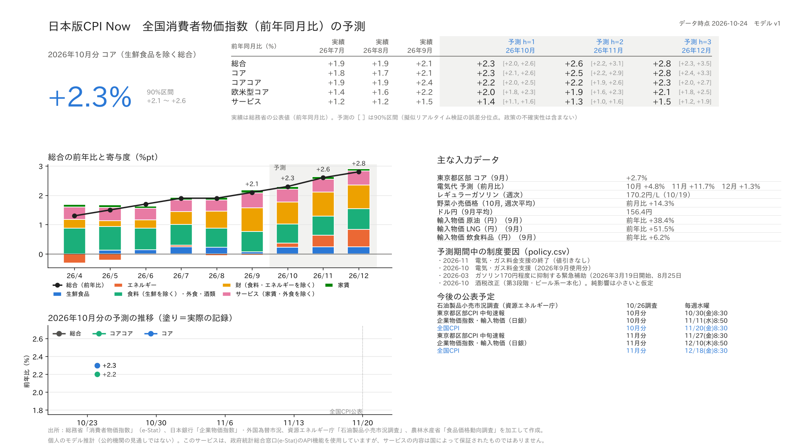

# 日本版 CPI Now（jp-cpinow）

全国消費者物価指数（CPI）の前年同月比を、最新の公表月から **1〜3か月先（h=1〜3）** まで予測するモデル。
対象は5系列：**総合・コア（生鮮食品を除く総合）・コアコア（生鮮食品及びエネルギーを除く総合）・欧米型コア（食料（酒類を除く）及びエネルギーを除く総合）・サービス**。

> [!IMPORTANT]
> - **個人が趣味で作っているモデルの推計値です。** 総務省・日本銀行など公的機関の見通しではなく、各機関とも関係ありません。投資判断などには使わないでください。
> - 精度の数字は、公表カレンダーで切り出した**擬似リアルタイムのバックテスト**です（東京都区部は中旬速報ではなく確報値で代用、日銀統計は改定後の値）。実際の成績より良く出ている可能性があります。
> - 目安（2022–26年, 全国CPI公表直後, 総務省の公表値に対する平均絶対誤差）：コア h=1 0.13pt / h=2 0.22pt / h=3 0.30pt（前年比を横ばいと置くと 0.28 / 0.44 / 0.55）。東京都区部CPIの公表後は h=1 0.11pt。欧米型コアとサービスの h=1 は単純な季節パターンに勝てていません。詳しくは `SKILL.md`。
> - 予測区間には、まだ決まっていない政策（補助金の延長・縮小など）の不確実性は含まれません。



## しくみ（くわしくは `SKILL.md`）
- 総合を**重なりのない25の品目グループ（9ブロック）**に分け、グループごとに前月比を予測して2025年基準ウエイトで合成する。5系列はすべて同じ部品の足し算なので互いに矛盾しない。
- 前年比は「前年の動き（既知）」と「これからの前月比」に分解し、予測するのは後者だけ。
- **電気・都市ガス**：燃料費調整を再現（日銀 輸入物価の原油・LNG・一般炭の3か月平均、3〜5か月前）＋ 値引き単価・再エネ賦課金を明示的に入力。
- **ガソリン・灯油**：資源エネルギー庁の週次小売価格で当月をほぼ実測。
- **生鮮野菜**：農水省の週次小売価格（食品価格動向調査）で当月を推計。
- **東京都区部CPI**（全国より約3週間早い）が出ていれば、品目グループごとにブリッジ。
- その他のグループ：5年分の同月の中央値（季節性）＋ 直近の乖離・川上価格（輸入物価・企業物価・為替）によるリッジ回帰（E1）と、全グループ共通の LightGBM（E2）。
- **政策・制度要因**は `scripts/policy.csv` にまとめ、学習では除外、予測では既知のものだけ足し戻す。各行の「発表日」以降しかバックテストで使わない。

## 自動実行（GitHub Actions）
`.github/workflows/forecast.yml` が平日 12:07 と 16:43（日本時間）に動く（GitHub の定時実行は遅れることがある）。新しいデータが無ければ何もしない。

- 各統計の最新値を取得し、`data/vintages.sqlite` に差分だけ保存（ヴィンテージ）
- 新しい・改定されたデータがあった日だけ予測を記録し、`data/runs.csv` と `output/` をコミット
- 手動実行：Actions タブ → forecast → Run workflow（`force` で新データが無くても実行）

必要な Secret：`ESTAT_APP_ID`（e-Stat API のアプリケーションID）

## 手元で実行
```bash
pip install -r requirements.txt
export ESTAT_APP_ID=...
export JP_CPINOW_HOME=$PWD/data
python -m scripts.cli forecast --out output      # 予測・記録・レポート画像
python -m scripts.cli backtest --out output      # 擬似リアルタイム・バックテスト
python -m scripts.cli bands                      # 予測区間テーブルを作り直す（30分程度）
```

## 手で更新するファイル
| パス | 中身 |
|---|---|
| `scripts/policy.csv` | 補助金・税・制度変更（発表されたら追記。発表日を必ず書く） |
| `scripts/schedule.csv` | 今後の公表予定（レポートの表示用） |

## 出力
- `output/latest.png`：1枚まとめのレポート（直近3か月の公表値＋3か月先の予測と90%区間、寄与度、予測の推移、入力データ、制度要因、公表予定）
- `output/forecast.csv`：直近3か月の実績（公表値）と予測（90%区間つき）
- `output/forecast_contributions.csv`：総合の前年比の品目グループ別寄与度

## データの出典と利用条件
| 出典 | 使っているデータ | 利用条件 |
|---|---|---|
| 総務省統計局（e-Stat） | 消費者物価指数（2025年基準、全国・東京都区部） | [https://www.e-stat.go.jp/api/terms-of-use](https://www.e-stat.go.jp/api/terms-of-use) |
| 日本銀行 | 企業物価指数（輸入物価・国内企業物価）、外国為替市況 | [https://www.boj.or.jp/about/copyright.htm](https://www.boj.or.jp/about/copyright.htm) |
| 資源エネルギー庁 | 石油製品小売市況調査 | [https://www.meti.go.jp/main/rules.html](https://www.meti.go.jp/main/rules.html) |
| 農林水産省 | 食品価格動向調査（野菜） | [https://www.maff.go.jp/j/use/link.html](https://www.maff.go.jp/j/use/link.html) |

出典の表記例：「消費者物価指数」（総務省）、「企業物価指数」（日本銀行）等を加工して作成。

このサービスは、政府統計総合窓口(e-Stat)のAPI機能を使用していますが、サービスの内容は国によって保証されたものではありません。

## ライセンス
- コード（`scripts/`, `vendor/`, ワークフロー）：MIT License（`LICENSE`）
- データ：上表の各出典の利用条件に従います（MIT の対象外）。
